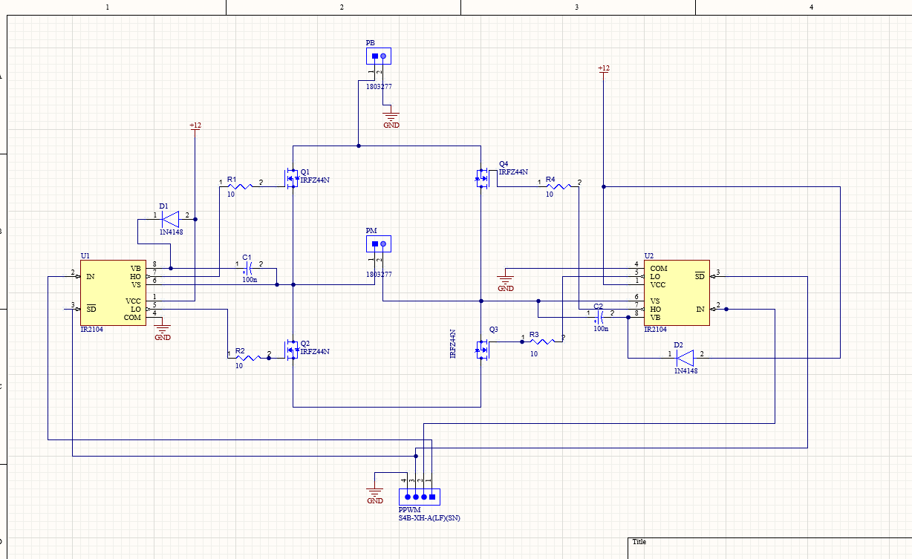
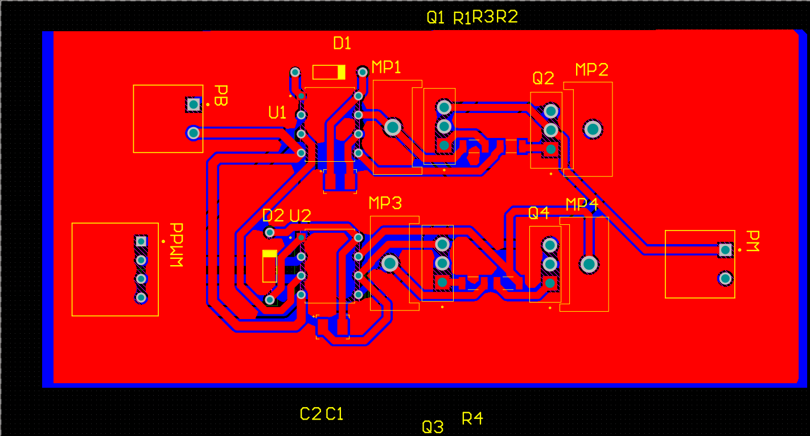

<div align="center">

# ⚡ 24V / 16A (350W) H-Bridge DC Motor Driver — PCB & Embedded Control
### *End-to-End Power Electronics Design in Altium Designer, Proteus Simulation & STM32F407G Real-Time Firmware for an Autonomous Agricultural Robot*

[](https://www.altium.com/)
[-03234B?style=for-the-badge&logo=stmicroelectronics&logoColor=white)](https://www.st.com/)
[]()
[]()

**Authors:** **Imen Rojbani** & **Eya Yousfi** — *Electrical Engineering Students, ENSIT (National Higher Engineering School of Tunis)*  
*Supervisor: Prof. Fethi Farhani | Academic Year: 2025–2026*

</div>

---

## 🎯 Engineering Overview & System Architecture

Autonomous agricultural robots operating on uneven terrain require rugged, high-efficiency traction electronics capable of handling continuous currents up to **16 A** (with **40 A** startup surges), harsh thermal environments (up to **60 °C**), and electromagnetic interference (EMI) without relying on fragile monolithic ICs.

This project delivers a complete **discrete full H-Bridge DC motor driver** engineered from first-principles power calculations to PCB manufacturing and field validation on a 4WD agricultural robot:

```text
┌──────────────────────────┐    CAN Bus (1 Mbit/s)    ┌──────────────────────────┐    20 kHz PWM + SD    ┌────────────────────────────────────┐
│     Raspberry Pi 4       │ ───────────────────────▶ │       STM32F407G         │ ────────────────────▶ │    H-Bridge Power PCB (Altium)     │
│  (ROS2 Path Planning)    │ ◀─────────────────────── │  TIM1 (168 MHz / ARR8399)│ ◀──────────────────── │  2× IR2104 + 4× IRFZ44N MOSFETs    │
└──────────────────────────┘   Speed / Fault Frames   └──────────────────────────┘  EXTI Fault (< 1 µs)  └─────────────────┬──────────────────┘
                                                                                                                           │ 24V / 16A (350W)
                                                                                                                           ▼
                                                                                                            ┌──────────────────────────────┐
                                                                                                            │  Brushed DC Traction Motor   │
                                                                                                            │  Ra = 0.8 Ω  |  La = 1.2 mH  │
                                                                                                            └──────────────────────────────┘

```
## 🛠️ Hardware Design & Altium Designer Implementation

### 1. Electrical Schematic (`SchDoc`)
<div align="center">
  
</div>

* **Dual Half-Bridge Gate Drivers (`U1, U2` — IR2104, SOIC-8):** Drives high-side (`Q1, Q3`) and low-side (`Q2, Q4`) N-channel MOSFETs with built-in **520 ns hardware dead-time**, under-voltage lockout (UVLO), and 3.3 V logic compatibility.
* **Bootstrap High-Side Supply (`C1, C2` = 100 nF / 25 V X7R + `D1, D2` = 1N4148):** Dimensioned for a total gate + UVLO + leakage charge of **85.5 nC** with a 5× safety factor, sustaining up to **98% duty cycle at 20 kHz**.
* **Power Switching Stage (`Q1–Q4` — IRFZ44N, TO-220):** Low conduction resistance (**R<sub>DS(on)</sub> = 17.5 mΩ**), **55 V** breakdown rating, and **49 A** continuous drain capability, fitted with **10 Ω** gate resistors to damp parasitic LC ringing and control **dV/dt**.

### 2. Two-Layer Power PCB Layout (`PcbDoc` — IPC-2221 Compliant)
<div align="center">
  
</div>

* **Board Stackup & Dimensions:** 2-layer FR4 (**1.6 mm** thickness, **100 × 80 mm** footprint) with **70 µm (2 oz) heavy copper** for high-current thermal and electrical robustness.
* **IPC-2221 Power Track Sizing:** Calculated minimum width of 0.54 mm at ΔT = 20 °C, scaled with a **6× safety factor to 3.0 mm** wide power traces (`PB` battery bus, switching nodes, and `PM` motor terminals).
* **EMI Shielding & Low-Inductance Loops:** Solid bottom-layer ground plane stitched with **0.8 mm vias** every 2 mm, symmetric half-bridge placement, and local decoupling (`2200 µF / 50 V` bulk electrolytic + `100 nF` X7R ceramic within 1–2 mm of driver pins).

---

## 📊 Bill of Materials (BOM Summary)

| Designator | Component | Specification / Package | Engineering Role |
| :--- | :--- | :--- | :--- |
| **U1, U2** | Gate Driver IC | **IR2104** (SOIC-8) | Half-bridge driver, 520 ns internal dead-time, `SD` shutdown |
| **Q1 – Q4** | Power MOSFET | **IRFZ44N** (TO-220) | 55 V / 49 A N-MOSFET, R<sub>DS(on)</sub> = 17.5 mΩ + clip-on heatsink |
| **C1, C2** | Bootstrap Capacitor | **100 nF / 25 V** (X7R) | High-side floating gate drive supply (α<sub>max</sub> = 98%) |
| **D1, D2** | Bootstrap Diode | **1N4148** (DO-35) | Fast-recovery bootstrap recharge diode (V<sub>RRM</sub> = 100 V) |
| **R1 – R4** | Gate Resistor | **10 Ω / 0.25 W** | Controls switching slew rate (`dV/dt`) & prevents ringing |
| **R5** | Current Shunt | **10 mΩ / 5 W** (1%) | Precision current sensing (`160 mV @ 16 A`) to LM393 comparator |
| **C<sub>bulk</sub>, C<sub>HF</sub>** | Bus Decoupling | **2200 µF / 50 V** + **100 nF** | Suppresses 24 V bus voltage ripple and switching spikes |

---

## 💻 Real-Time Embedded Firmware (`STM32F407G`)

* **Unipolar PWM Strategy (20 kHz):** Configured on **TIM1** (`APB2 = 168 MHz`, `PSC = 0`, `ARR = 8399`), cutting switching losses by **50%** compared to bipolar modulation while maintaining low current ripple (**ΔI = 0.20 A**).
* **Sub-Microsecond Hardware Overcurrent Protection:** An **LM393** comparator monitors the 10 mΩ shunt resistor (`200 mV` threshold = **20 A**), triggering an STM32 **EXTI interrupt** and pulling the IR2104 `SD` shutdown pins LOW in **< 1.2 µs**.
* **CAN Bus Telemetry (`1 Mbit/s`):** Exchanges real-time velocity commands (`0x101 / 0x102`), encoder RPM + current feedback (`0x201 / 0x202`), and fault alarms (`0x301`) with a **Raspberry Pi 4 (ROS2)** master controller.

---

## 🔬 Design vs. Simulation vs. Experimental Validation

Tested on a laboratory bench using a **Rigol DS1054Z** oscilloscope, **Testec TT-SI 9001** differential probe, **HIOKI 3285** current clamp, and **FLIR C3** infrared thermal camera:

| Performance Metric | Design Target | Proteus ISIS Simulation | Experimental Measurement | Status |
| :--- | :---: | :---: | :---: | :---: |
| **Hardware Dead-Time** | ≥ 350 ns | 530 ns | **510 ns** (480–560 ns) | ✅ Verified |
| **Drain-Source Overshoot (ΔV<sub>DS</sub>)** | < 15% V<sub>bus</sub> | 13% | **11%** | ✅ Verified |
| **Continuous Nominal Current** | 16.0 A | 16.0 A | **15.7 A** | ✅ Verified |
| **Max MOSFET Temperature (T<sub>j</sub>)** | < 175 °C | 72 °C | **76 °C** (99 °C margin) | ✅ Verified |
| **Overcurrent Shutdown Latency** | < 2.0 µs | 0.9 µs | **1.2 µs** | ✅ Verified |
| **Overall Electrical Efficiency (η)** | ≥ 90.0% | 96.8% | **94.6%** | ✅ Verified |

---

## 📂 Repository Structure

```text
agricultural-robot-dc-motor-driver/
├── hardware/
│   ├── altium_schematic_hbridge.png      # Full H-Bridge electrical schematic (Altium Designer)
│   └── altium_pcb_routing.png            # 2-layer PCB routing & ground plane (Altium Designer)
├── firmware/
│   └── motor_driver_stm32.c              # STM32F407G HAL driver (20 kHz TIM1, ramp, EXTI fault)
├── Rapport_PFA2_Driver_Moteur_DC.pdf     # Full engineering report (calculations, PCB, tests)
└── README.md
